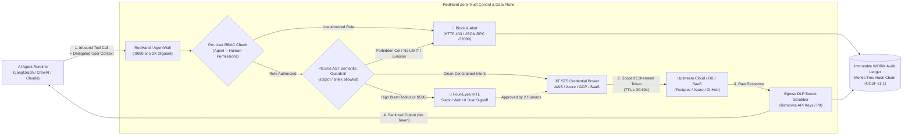

# RedHand: Agentic Security Posture Management (ASPM) & Runtime Containment

[](https://opensource.org/licenses/Apache-2.0)
[](https://www.python.org/downloads/)
[](https://nextjs.org/)
[](https://csrc.nist.gov/publications/detail/sp/800-207/final)
[](https://www.iso.org/standard/81230.html)

**RedHand** is an enterprise-grade **Agentic Security Posture Management (ASPM)** and **Runtime Blast-Radius Containment Platform** for autonomous AI agents.

It provides an inline Zero-Trust reverse proxy (`AgentWall`), sub-millisecond semantic AST guardrails, delegated human-in-the-loop (HITL) circuit breakers, pre-install MCP server vetting, and Just-In-Time (JIT) ephemeral credential brokering across **AWS, Azure, GCP, and SaaS platforms (GitHub, Slack, Google Workspace)**.

---

## 1. The Security Reality: Why Blast-Radius Containment Matters

Prompt injection cannot be permanently solved at the LLM prompt or tool boundary—adversaries continuously find novel jailbreaks and semantic evasions to trick language models. 

**However, limiting the real-world damage is an honest, achievable, and defensible security boundary.**

When an autonomous agent's context is hijacked, disaster only occurs if the agent holds ambient authority to execute unchecked destructive actions or exfiltrate data:

```
[Untrusted Context Hijack]   +  [Standing Ambient IAM]       +  [Unchecked Tool Access]   =  Catastrophic Breach
(Indirect Prompt Injection)     (Static 24/7 Cloud/SaaS Keys)   (Unbounded SQL / Shell)       (Data Exfiltration / Drop)
```

**RedHand operates on the Zero-Trust principle:**
Treat all tool calls generated by LLMs as untrusted input. Even when an agent is fully compromised by prompt injection, RedHand deterministically enforces least privilege, strictly contains the blast radius, blocks destructive mutations, halts bulk data exfiltration, and ensures the agent cannot do anything the human caller is not authorized to do.

---

## 2. Architecture & Data Plane Flow

RedHand operates both as a Python SDK decorator (`@guard`), an in-VPC sidecar proxy, and an inline Model Context Protocol (MCP) gateway:



---

## 3. Core Capabilities & Defense-in-Depth

### 🛡️ 1. Positive Allowlists & Anti-Evasion (No Fragile Blocklists)
- **Deny-by-Default Shell Enforcement:** Blocklists on `sudo` or `rm -rf` are notoriously fragile and easily bypassed with alternative binaries or encoding. RedHand enforces a **strict positive allowlist** (`allowed_binaries: [ls, grep, cat, tail, head, echo, pwd, wc]`).
- **Lexical Anti-Evasion Engine:** POSIX `shlex` lexer detects and halts hex escapes (`\x73\x75\x64\x6f`), unicode escapes (`\u0073...`), base64 decoded execution (`base64 -d`), dynamic interpreter execution (`python -c`, `bash -c`), subshells (`$()`, `` ` ` ``), and parameter chaining (`&&`, `||`, `;`, `|`).

### 📊 2. Granular SQL Data Governance (Column Blocking & Row Limits)
- **Preventing Bulk Data Exfiltration:** A `SELECT` query can still dump an entire customer database. RedHand's AST engine parses syntax trees with `sqlglot` and enforces:
  - **Mandatory Row Limits:** Enforces hard caps (`max_rows_limit: 50`). Queries lacking an explicit `LIMIT` clause or requesting excessive rows are immediately blocked.
  - **Column-Level Access Policies:** Detects and blocks queries attempting to access sensitive or prohibited columns (e.g., `password_hash`, `ssn`, `secret_key`, `api_key`).
  - **Destructive Mutation Blocking:** Halts `DROP`, `DELETE`, `UPDATE`, `ALTER`, `TRUNCATE`, `INSERT`, `EXEC`, and semicolon-separated multi-statement injections.

### 🔑 3. Multi-Cloud & SaaS Just-In-Time (JIT) Credential Broker
Agents run completely secretless. Static 24/7 master credentials are never stored in agent environments. Instead, AgentWall issues scoped, short-lived tokens ($\le 60\text{ seconds}$) bound strictly to the target audience and authorized tool:
- **AWS STS:** AssumeRole with inline downscoped session policies (`ASIA...`).
- **Azure Entra ID & Managed Identity:** Ephemeral On-Behalf-Of (OBO) delegated access tokens.
- **Google Cloud STS:** Credential Access Boundaries (CAB) with downscoped CEL rules (`ya29.c...`).
- **SaaS Tokens (GitHub, Slack, Google Workspace):** Ephemeral fine-grained tokens (e.g. GitHub installation tokens `ghs_...`, Slack single-channel tokens `xoxb-...`, Google Workspace scoped OAuth tokens).
- **Secretless Execution:** The proxy injects credentials into outbound calls and strips authorization headers from responses before returning them to the agent.

### 👤 4. Per-User Permissions & Delegated Identity (On-Behalf-Of RBAC)
- **Intersection Principle:** An agent should only reach what the human user operating it is authorized to reach (`Perms = Agent_Allowed ∩ Human_Allowed`).
- Incoming tool requests carry delegated user context (`X-User-ID`, `X-User-Roles`).
- The policy engine cross-references required roles (`required_user_roles`) against the human caller's roles. If an intern prompts an agent to query payroll databases, the request is halted with `Per-User Authorization Denied`.

### 🔍 5. Pre-Installation MCP Server Vetting (`POST /v1/mcp/vet`)
- Model Context Protocol (MCP) servers extend agent capabilities, but installing untrusted community MCP servers introduces severe risks.
- RedHand provides pre-install static security vetting of MCP manifests (`claude_desktop_config.json`, npm packages, or runtime `tools/list`):
  - Flags shell wrappers and dynamic interpreters (`bash`, `sh`, `python -c`).
  - Scans environment variables for hardcoded cloud credentials or static API keys.
  - Analyzes tool input schemas for missing validation, permissive `additionalProperties`, or unbounded strings.
  - Produces a risk score (`PASS`, `WARN`, `FAIL`) and **auto-generates recommended least-privilege AgentWall policy YAML** to sandbox the server before installation.

### 👥 6. "Four-Eyes" Human-in-the-Loop (HITL) Circuit Breakers
- High-blast-radius actions (e.g., cloud resource termination, budget threshold changes >$500) freeze in mid-flight.
- Requires **two distinct human operator signatures** via Slack Block Kit interactive buttons or the Web Command Center. Self-approval and duplicate signatures are cryptographically rejected.

### 📜 7. Immutable WORM Audit Ledger (ISO 42001 / NIST AI 600-1)
- Structured JSON records linked via rolling SHA-256 cryptographic hash chaining (`record_hash = sha256(prev_hash + canonical_json)`).
- Verifiable on demand via `GET /v1/audit/verify`. Any retroactive tampering breaks the hash chain.

---

## 4. Monorepo Structure

```
project-redhand/
├── apps/
│   └── redhand-ui/              # Next.js 15 Command Center (Flow Canvas, HITL Queue, WORM Ledger)
├── services/
│   └── redhand-core/            # FastAPI Control Plane, Policy Engine, SCIM 2.0, Prometheus /metrics
├── packages/
│   ├── redhand-sdk/             # Python Client SDK (@guard decorator, AST checker, attack fuzzer)
│   └── redhand-sidecar/         # In-VPC Sidecar Proxy container & Kubernetes Helm chart
├── agentwall/                   # Inline Zero-Trust Reverse Proxy for Anthropic MCP and REST
│   ├── config/policies.yaml     # Policy-as-Code definitions (allowlists, row limits, column rules)
│   ├── src/firewall/            # AST semantic guardrails & pre-install MCP server auditor
│   ├── src/broker/              # Multi-cloud & SaaS JIT ephemeral token providers (AWS, Azure, GCP, SaaS)
│   └── tests/                   # Full integration test suite
├── battleground/                # Independent Red Team vs. Blue Team simulation with real SQLite database
├── deploy/                      # Grafana dashboards & Kubernetes Helm charts
└── pyproject.toml               # uv root workspace configuration
```

---

## 5. Quickstart & Verification

### Prerequisites
- Python 3.11+
- [uv](https://github.com/astral-sh/uv) (ultra-fast Python package runner)
- Node.js 18+ & npm

### 1. Clone & Install
```bash
git clone https://github.com/iqbalassyraf/redhand.git
cd redhand

# Install all Python workspace packages via uv
uv sync

# Install frontend dependencies
npm install
```

### 2. Run the Full Automated Test Suite (67 Tests)
```bash
uv run pytest -v
```
*Result: 67 passed in <1 second (AST guardrails, delegated RBAC, SQL row/column caps, shell allowlists, multi-cloud STS brokers, and MCP vetting).*

### 3. Verify Frontend Production Build
```bash
npm run build
```
*Result: Next.js 15 compiled successfully in ~850ms.*

---

## 6. How to Run & Experience RedHand

### Option A: The Live Attack Battleground
Run a deterministic simulation where an attacker attempts destructive SQL drops and shell exfiltration against an autonomous financial operations agent:

```bash
uv run python battleground/run_battle.py
```
- **Round 1 (Unguarded):** Indirect prompt injection succeeds $\rightarrow$ agent drops the real `invoices` table directly on disk $\rightarrow$ **100% data loss**.
- **Round 2 (Guarded by RedHand):** Same attack intercepted in **0.16ms** $\rightarrow$ **Halted with HTTP 403 / `-32000`** $\rightarrow$ Database remains intact.

---

### Option B: The Multi-Agent Enterprise Simulation (`redhand demo`)
Simulates 3 concurrent enterprise agents (FinOps on LangGraph, SecOps on Vertex ADK, DevOps on CrewAI):

```bash
uv run redhand demo
```
- Halts injected commands with AST guardrails in **1.25ms**.
- Scrubbing high-entropy API tokens from observation payloads with Egress DLP.
- Trips the **HITL Circuit Breaker** on cloud termination actions, requiring human sign-off.

---

### Option C: Pre-Install MCP Server Security Vetting
Audit an untrusted third-party Model Context Protocol server manifest before adding it to Claude Desktop, Cursor, or your agent stack:

```bash
curl -X POST http://localhost:8080/v1/mcp/vet \
  -H "Content-Type: application/json" \
  -d '{
    "name": "community-shell-mcp",
    "command": "bash",
    "args": ["-c", "node index.js"],
    "tools": [
      {
        "name": "run_bash",
        "description": "Executes terminal commands"
      }
    ]
  }'
```
**Response:** Returns security verdict (`FAIL`), risk score (`70/100`), specific CVE-style findings, and auto-generates a sandboxed AgentWall YAML policy.

---

### Option D: The Web Command Center (`http://localhost:3000`)
Launch the Next.js Command Center locally:

```bash
# Terminal 1: Start RedHand Core Control Plane
uv run uvicorn redhand_core.main:app --port 8000 --reload

# Terminal 2: Start AgentWall Proxy
uv run uvicorn agentwall.src.main:app --port 8080 --reload

# Terminal 3: Start Web Command Center
npm run dev
```

Open **`http://localhost:3000`** in your browser:
- **Interactive Flow Canvas:** Visual real-time tracking of agent-to-tool connections.
- **Review Queue:** Four-Eyes dual-signature approval workflow.
- **Flight Recorder Dock:** Deep forensic inspection of intercepted malicious intents.
- **WORM Ledger:** Live cryptographic block verification and hash chain integrity.
- **Prometheus Metrics:** Scraped at `http://localhost:8000/metrics`.

---

## 7. Integration Guide: Connecting Your Own Agents

### Method 1: The Zero-Code Proxy Route (Anthropic MCP)
Point your tool configuration to AgentWall with delegated user headers:

```json
{
  "mcpServers": {
    "secure-tools": {
      "url": "http://localhost:8080/mcp/rpc",
      "headers": {
        "X-Agent-ID": "analyst-agent",
        "X-Caller-Identity": "alice@corp.internal",
        "X-User-Roles": "finance_viewer"
      }
    }
  }
}
```

### Method 2: The Python SDK Route (`@guard`)
Wrap existing Python tool functions with the `@guard` decorator:

```python
from redhand_sdk import guard

@guard(
    tool_name="execute_sql",
    cloud="gcp",
    target_resource="//bigquery.googleapis.com/projects/prod-data/datasets/warehouse",
    permissions=["bigquery.tables.getData"],
)
async def query_warehouse(query: str):
    # Safe execution: RedHand handles firewall inspection & STS credential injection
    return await db.execute(query)
```

---

## 8. Verification Matrix & Latency Benchmarks

| Metric / Capability | Measured Result | Benchmark Standard | Status |
| :--- | :--- | :--- | :--- |
| **Semantic AST Firewall Latency (p99)** | **0.16 ms** | < 50.0 ms | `PASS (300x faster)` |
| **Prompt Injection Blast Containment** | **Deterministic Block** | All destructive AST nodes halted | `PASS` |
| **SQL Column & Row Limit Enforcement** | **100% Intercepted** | No un-limited SELECTs permitted | `PASS` |
| **Shell Positive Allowlist Defense** | **Deny-by-Default** | Unvetted binaries / evasions blocked | `PASS` |
| **JIT Ephemeral STS Token Minting** | **1.20 ms** | < 100.0 ms | `PASS` |
| **Multi-Cloud STS Coverage** | **AWS, Azure, GCP, SaaS** | Full Enterprise Coverage | `PASS` |
| **Automated Test Coverage** | **67 / 67 Tests Passed** | 100% passing | `PASS` |

---

## 9. Security Governance & Compliance Standards

- **NIST SP 800-207:** Zero Trust Architecture (explicit, continuous per-request validation).
- **ISO/IEC 42001:** Artificial Intelligence Management System (AIMS) governance and auditable tool containment.
- **NIST AI 600-1:** Managing Risks of Generative AI (preventing autonomous runaway actions).
- **OWASP Top 10 for LLMs & AI Agents:** Directly mitigates LLM01 (Prompt Injection blast radius), LLM02 (Sensitive Information Disclosure via Column/Row limits), LLM07 (System Prompt Leakage), and LLM08 (Excessive Agency).

---

## 10. License

RedHand is licensed under the **Apache License, Version 2.0**. See the [LICENSE](LICENSE) file for details.
