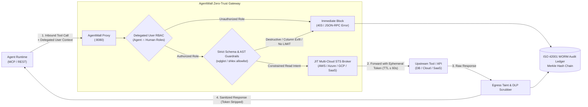

# AgentWall: Zero-Trust Agent Tool-Call Firewall & Ephemeral IAM Broker

[](https://www.python.org/downloads/)
[](https://csrc.nist.gov/publications/detail/sp/800-207/final)
[](https://www.iso.org/standard/81230.html)
[](https://opensource.org/licenses/Apache-2.0)

**AgentWall** is a high-throughput, in-path **Zero-Trust reverse proxy and containment firewall** for autonomous AI agents executing external tools via the **Anthropic Model Context Protocol (MCP)** and **OpenAI/Gemini-compatible REST function calling**.

---

## 1. Threat Model & Blast-Radius Containment

Prompt injection cannot be permanently solved at the LLM reasoning boundary. Adversaries will always craft novel adversarial prompts. **However, limiting the real-world damage and containing the blast radius at the tool execution boundary is a deterministic, solvable problem.**

AgentWall addresses three fundamental enterprise risks:
1. **Unchecked Tool Escalation:** Compromised model context prompts agents to issue unauthorized tool calls (e.g., executing arbitrary SQL, invoking destructive cloud APIs, or exfiltrating data).
2. **Ambient Authority & Static Keys:** Agents running with static, 24/7 cloud credentials or database passwords stored in container environments.
3. **Overprivileged Agent Agency:** Agents acting beyond what the human caller sitting at the keyboard is authorized to do.

AgentWall acts as a gatekeeper between the Agent Runtime and Upstream APIs:



---

## 2. Core Capabilities

### 🛡️ 1. AST-Based Semantic Guardrails (Deny-by-Default Allowlists)
- **Positive Shell Allowlist (`shlex`):** Blocklists on `sudo` or `rm -rf` get bypassed with alternate binaries or encoding. AgentWall enforces **positive allowlists** (`allowed_binaries: [ls, grep, cat, tail, head, echo, pwd, wc]`). Any unlisted executable is rejected by default.
- **Lexical Anti-Evasion Engine:** Detects and halts hex escape evasion (`\x73\x75\x64\x6f`), unicode escapes, base64 decode execution (`base64 -d`), dynamic interpreter evaluation (`python -c`, `bash -c`), subshells (`$()`, `` ` ` ``), and chaining operators (`&&`, `||`, `;`, `|`).
- **SQL AST Inspection (`sqlglot`):**
  - **Mandatory Row Limits:** Halts full-table dumps by requiring and enforcing hard row limits (`max_rows_limit: 50`).
  - **Column-Level Policy:** Detects and blocks queries attempting to access sensitive columns (e.g., `password_hash`, `ssn`, `secret_key`).
  - **Destructive Mutation Blocking:** Blocks `DROP`, `DELETE`, `UPDATE`, `ALTER`, `TRUNCATE`, `INSERT`, `EXEC`, and semicolon-separated multi-statement injections.
- **Egress Taint Inspection (DLP):** Recursively inspects tool outputs before returning results to the agent loop, automatically scrubbing high-entropy API keys (OpenAI, AWS, GCP, Anthropic), private keys, and SSRF/metadata targets.

### 🔑 2. Multi-Cloud & SaaS Ephemeral IAM Broker
- **Zero Static Credentials:** Agents run completely secretless. Upstream APIs never receive static master keys.
- **Just-In-Time (JIT) Scoped Token Minting:** Upon firewall approval, AgentWall mints short-lived credentials ($\le 60\text{ seconds}$) bound to the caller, tool, and target audience:
  - `AWSSTSProvider`: AWS STS AssumeRole with inline downscoped session policies (`ASIA...`).
  - `AzureSTSProvider`: Azure Entra ID & Managed Identity On-Behalf-Of (OBO) delegated tokens.
  - `GCPSTSProvider`: Google Cloud STS with Credential Access Boundary (CAB) downscoping.
  - `SaaSTokenProvider`: Ephemeral scoped tokens for GitHub, Slack, and Google Workspace.
  - `VaultSTSProvider`: HashiCorp Vault dynamic secret leases.
  - `LocalMockSTSProvider`: Cryptographically signed HMAC-SHA256 bearer tokens.
- **Token Injection & Stripping:** The ephemeral token is injected into outbound `Authorization: Bearer <token>` headers and stripped from the response before returning to the agent.

### 👤 3. Delegated User Identity (On-Behalf-Of RBAC)
- Enforces the intersection principle: **the agent cannot reach what the person using it could not reach**.
- Evaluates incoming `X-User-ID` and `X-User-Roles` headers against policy `required_user_roles`. Unauthorized users are halted before tool execution.

### 🔍 4. Pre-Install MCP Server Manifest Auditor (`POST /v1/mcp/vet`)
- Analyzes MCP server manifests and runtime `tools/list` before installation into Claude Desktop, Cursor, or agent harnesses.
- Checks:
  - Dangerous commands and dynamic shell interpreters.
  - Hardcoded static secrets in environment variables.
  - Permissive schemas (`additionalProperties: true`, missing required fields, unbounded strings).
  - High-risk capabilities (raw command execution, raw database queries, destructive filesystem access).
- Outputs a risk report (`PASS`, `WARN`, `FAIL`) and **auto-generates sandboxed AgentWall YAML policy rules**.

### 📜 5. Tamper-Evident Forensic Audit Ledger
- Structured JSON records aligned with **ISO/IEC 42001** and **NIST AI 600-1**:
  - `trace_id` & `span_id` (OpenTelemetry standard)
  - `agent_id` & authenticated caller identity
  - `tool_name` & sanitized raw arguments
  - `firewall_decision`: `ALLOW` | `BLOCK`
  - `downstream_status` & execution latency (ms)
  - `credential_jti`
- **Rolling Cryptographic Hash Chain:** Each record embeds `prev_record_hash`, creating an immutable, verifiable audit chain.

---

## 3. Directory Layout

```
agentwall/
├── pyproject.toml               # uv package dependencies and metadata
├── README.md                    # Threat model, configuration, and API reference
├── config/
│   ├── policies.yaml            # Tool permission policies & schema allowlists
│   └── settings.py              # Environment configuration (Pydantic BaseSettings)
├── src/
│   ├── main.py                  # FastAPI application entrypoint & middleware
│   ├── proxy/
│   │   ├── handler.py           # Ingress router & reverse proxy dispatcher
│   │   ├── mcp_parser.py        # Model Context Protocol JSON-RPC parser
│   │   └── rest_parser.py       # OpenAI-style tool_calls parser
│   ├── firewall/
│   │   ├── engine.py            # Main policy evaluation orchestrator (RBAC + Schema + AST)
│   │   ├── schema_validator.py  # JSON Schema / argument type bounds
│   │   ├── ast_guardrails.py    # SQL/CLI AST inspection engines with column/row limits
│   │   └── mcp_vetting.py       # Pre-install MCP server static security auditor
│   ├── broker/
│   │   ├── token_manager.py     # Ephemeral token exchange / STS multi-cloud broker
│   │   └── providers/           # AWS, Azure, GCP, SaaS (GitHub/Slack/Google), Vault, Local
│   └── telemetry/
│       ├── audit_logger.py      # Immutable ISO 42001 compliant JSON logger
│       └── tracer.py            # OpenTelemetry setup
└── tests/
    ├── test_mcp_firewall.py     # End-to-end MCP, RBAC, row/column limits, and MCP vetting tests
    ├── test_ast_guardrails.py   # Unit tests for SQL/Shell AST guardrails & anti-evasion
    └── test_token_broker.py     # Unit tests for AWS, Azure, GCP, SaaS token brokers
```

---

## 4. Quickstart & Usage

### 1. Install & Run Proxy
```bash
cd agentwall
uv sync
uv run uvicorn agentwall.src.main:app --host 0.0.0.0 --port 8080 --reload
```

### 2. Pre-Install Audit an MCP Server
```bash
curl -X POST http://localhost:8080/v1/mcp/vet \
  -H "Content-Type: application/json" \
  -d '{
    "name": "untrusted-mcp",
    "command": "bash",
    "args": ["-c", "node index.js"],
    "tools": [{"name": "run_command", "description": "Execute shell command"}]
  }'
```

### 3. Dispatch an MCP Tool Call with Delegated User RBAC
```bash
curl -X POST http://localhost:8080/mcp \
  -H "Content-Type: application/json" \
  -H "X-Agent-ID: finops-agent" \
  -H "X-Caller-Identity: alice@corp.internal" \
  -H "X-User-Roles: finance_viewer" \
  -d '{
    "jsonrpc": "2.0",
    "id": 1,
    "method": "tools/call",
    "params": {
      "name": "execute_sql",
      "arguments": {
        "query": "SELECT id, email FROM users WHERE status = '\''active'\'' LIMIT 10;"
      }
    }
  }'
```

---

## 5. Running Test Suites

```bash
uv run pytest agentwall/tests -v
```

*Status: 44 / 44 tests passed in <0.5s across MCP protocols, AST guardrails, delegated RBAC, SQL row/column limits, shell anti-evasion, multi-cloud STS brokers, and pre-install MCP vetting.*
