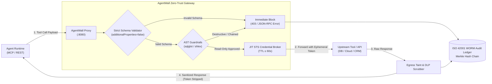

# AgentWall: Zero-Trust Agent Tool-Call Firewall & Ephemeral IAM Broker

[](https://www.python.org/downloads/)
[](https://csrc.nist.gov/publications/detail/sp/800-207/final)
[](https://www.iso.org/standard/81230.html)
[](https://opensource.org/licenses/Apache-2.0)

**AgentWall** (working title: `RedHand Proxy`) is a high-throughput, in-path **Zero-Trust reverse proxy and containment firewall** for autonomous AI agents executing external tools via the **Anthropic Model Context Protocol (MCP)** and **OpenAI/Gemini-compatible REST function calling**.

---

## 1. Threat Model & Architecture

Autonomous agents that invoke external tools create three catastrophic failure modes—the **Lethal Trifecta**:
1. **Indirect Prompt Injection & Tool Hijacking:** Compromised model context prompts agents to issue unauthorized tool calls (e.g., executing arbitrary SQL, invoking destructive cloud APIs, or exfiltrating data).
2. **Excessive Agency & Overprivileged Service Accounts:** Agents typically run with static, long-lived API keys and database passwords stored directly in runtime environments.
3. **Lack of Immutable Audit Trails:** Regulatory frameworks (ISO/IEC 42001, NIST AI 600-1, OWASP Top 10 for LLMs/Agents) mandate auditable proof of every automated action, input argument, and credential exchange.

AgentWall acts as a gatekeeper between the Agent Runtime and Upstream APIs:



---

## 2. Core Capabilities

### 🛡️ Inline AST-Based Semantic Guardrails
- **SQL Guardrail (`sqlglot`):** Enforces strict read-only semantics at the Abstract Syntax Tree level (`SELECT` permitted; `DROP`, `DELETE`, `UPDATE`, `ALTER`, `TRUNCATE`, `INSERT`, `EXEC`, and multi-statement injection attempts are permanently blocked).
- **POSIX Shell Guardrail (`shlex`):** Detects and halts command chaining (`&&`, `||`, `;`, `&`), subshells (`$()`, ````), process substitution, and dangerous primitives (`sudo`, `eval`, `curl | sh`, `rm`, `kill`).
- **Egress Taint Inspection (DLP):** Recursively inspects tool outputs before returning results to the agent loop, automatically scrubbing high-entropy API keys (OpenAI, AWS, GCP, Anthropic), private keys, and SSRF/metadata targets.

### 🔑 Ephemeral IAM Credential Broker
- **Zero Static Credentials:** Agents run completely secretless. Upstream APIs never receive static API keys or long-lived database credentials.
- **Just-In-Time (JIT) Scoped Token Minting:** Upon firewall approval, AgentWall mints a short-lived token ($\le 60\text{ seconds}$) bound strictly to the caller, tool, and target endpoint using pluggable providers:
  - `LocalMockSTSProvider`: Cryptographically signed HMAC-SHA256 bearer tokens.
  - `GCPSTSProvider`: Google Cloud STS Credential Access Boundary (CAB) downscoping.
  - `VaultSTSProvider`: HashiCorp Vault dynamic secret leases.
- **Token Injection & Stripping:** The ephemeral token is injected into outbound `Authorization: Bearer <token>` headers and stripped from the response before returning to the agent.

### 📜 Tamper-Evident Forensic Audit Ledger
- Structured JSON records aligned with **ISO/IEC 42001** and **NIST AI 600-1**:
  - `trace_id` & `span_id` (OpenTelemetry standard)
  - `agent_id` & authenticated caller identity
  - `tool_name` & sanitized raw arguments
  - `firewall_decision`: `ALLOW` | `BLOCK` | `REDACT`
  - `downstream_status` & execution latency (ms)
  - `credential_jti`
- **Rolling Cryptographic Hash Chain:** Each record embeds `prev_record_hash`, creating an immutable, verifiable audit chain.

---

## 3. Directory Layout

```
agentwall/
├── pyproject.toml               # uv package dependencies and metadata
├── README.md                    # Setup, threat model, and usage documentation
├── config/
│   ├── policies.yaml            # Tool permission policies & schema allowlists
│   └── settings.py              # Environment configuration (Pydantic BaseSettings)
├── src/
│   ├── main.py                  # FastAPI application entrypoint & middleware
│   ├── proxy/
│   │   ├── handler.py           # Ingress router & reverse proxy dispatcher
│   │   ├── mcp_parser.py        # Model Context Protocol JSON-RPC parser
│   │   └── rest_parser.py       # OpenAI-style tool_calls parser
│   ├── firewall/
│   │   ├── engine.py            # Main policy evaluation orchestrator
│   │   ├── schema_validator.py  # JSON Schema / argument type bounds
│   │   └── ast_guardrails.py    # SQL/CLI AST inspection engines
│   ├── broker/
│   │   ├── token_manager.py     # Ephemeral token exchange / STS mock & adapter
│   │   └── providers/           # Extensible providers (Vault, GCP STS, Local Mock)
│   └── telemetry/
│       ├── audit_logger.py      # Immutable ISO 42001 compliant JSON logger
│       └── tracer.py            # OpenTelemetry setup
└── tests/
    ├── test_mcp_firewall.py     # Unit tests for MCP interception & blocking
    ├── test_ast_guardrails.py   # Test SQL injection and CLI chaining blocks
    └── test_token_broker.py     # Test token minting and expiration
```

---

## 4. Quickstart & Installation

### 1. Install Dependencies
```bash
cd agentwall
uv sync
```

### 2. Run the Proxy Server
```bash
uv run uvicorn agentwall.src.main:app --host 0.0.0.0 --port 8080 --reload
```

---

## 5. Usage Examples

### Anthropic MCP JSON-RPC Request (`POST /mcp`)

#### Benign Read-Only SQL Tool Call (Approved):
```bash
curl -X POST http://localhost:8080/mcp \
  -H "Content-Type: application/json" \
  -H "X-Agent-ID: finops-analyzer" \
  -d '{
    "jsonrpc": "2.0",
    "id": 1,
    "method": "tools/call",
    "params": {
      "name": "execute_sql",
      "arguments": {
        "query": "SELECT id, email FROM users WHERE status = '\''active'\'' LIMIT 10;"
      }
    }
  }'
```
**Response:**
```json
{
  "jsonrpc": "2.0",
  "id": 1,
  "result": {
    "content": [{"type": "text", "text": "Query results..."}]
  }
}
```

#### Malicious Destructive SQL Injection (Blocked):
```bash
curl -X POST http://localhost:8080/mcp \
  -H "Content-Type: application/json" \
  -d '{
    "jsonrpc": "2.0",
    "id": 2,
    "method": "tools/call",
    "params": {
      "name": "execute_sql",
      "arguments": {
        "query": "DROP TABLE users;"
      }
    }
  }'
```
**Response:**
```json
{
  "jsonrpc": "2.0",
  "id": 2,
  "error": {
    "code": -32003,
    "message": "AgentWall Firewall Violation: Tool call '\''execute_sql'\'' blocked by policy.",
    "data": {
      "tool_name": "execute_sql",
      "violations": ["Prohibited destructive AST node detected: '\''Drop'\''"]
    }
  }
}
```

---

## 6. Running Test Suites

Run the full adversarial test suite across MCP protocols, AST guardrails, and token brokers:

```bash
uv run pytest agentwall/tests -v
```

**Measured Test Results:**
- `test_ast_guardrails.py`: 22 / 22 Passed (SQL, Shell chaining, Subshells, Egress DLP)
- `test_mcp_firewall.py`: 6 / 6 Passed (MCP JSON-RPC, Schema parameter pollution, REST proxy)
- `test_token_broker.py`: 4 / 4 Passed (Local STS, GCP STS, Vault, Hash chain integrity)
- **Total: 32 / 32 Passed in 0.33s**

